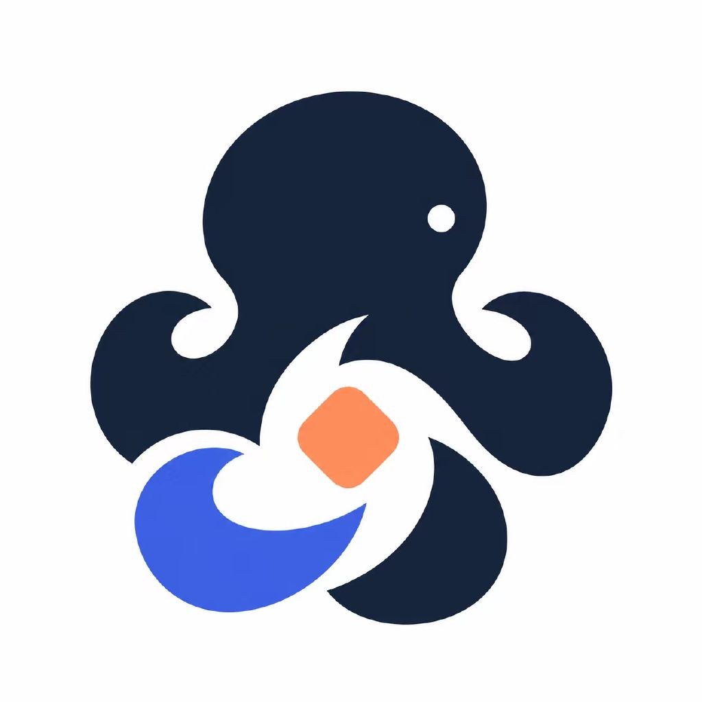
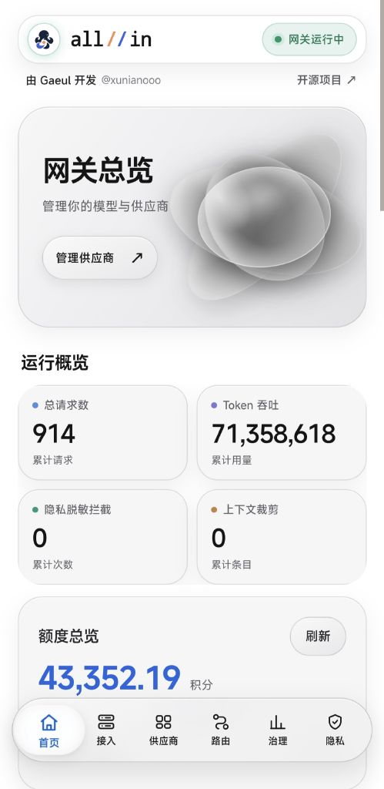
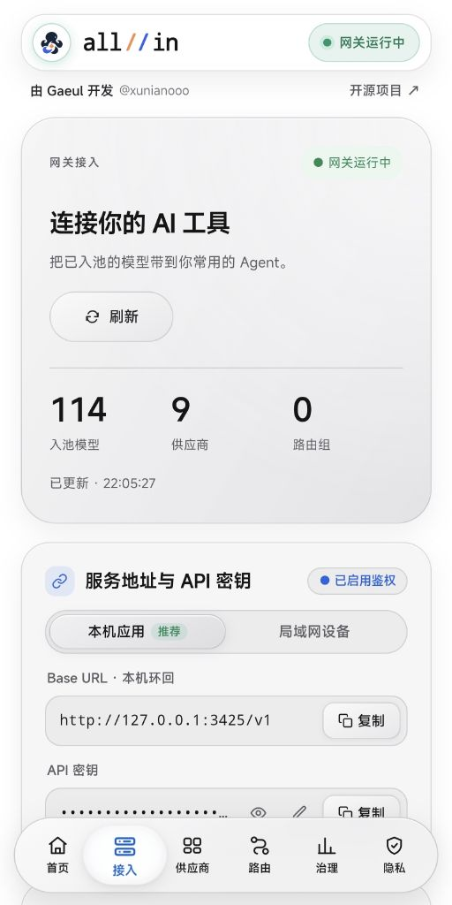
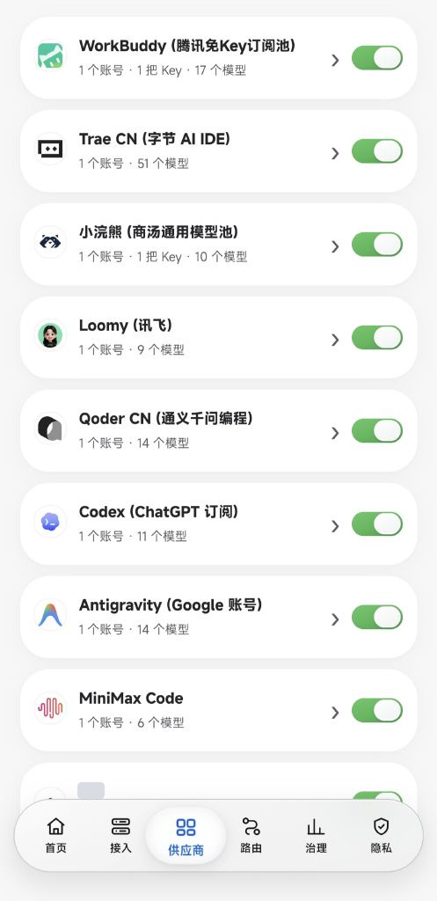
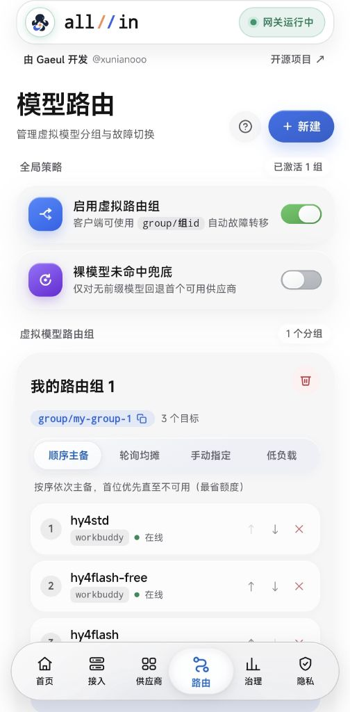
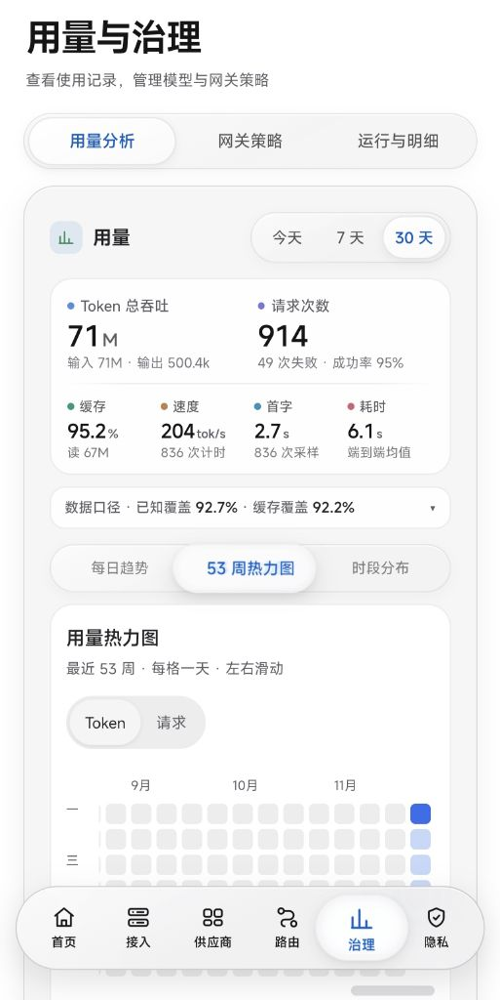
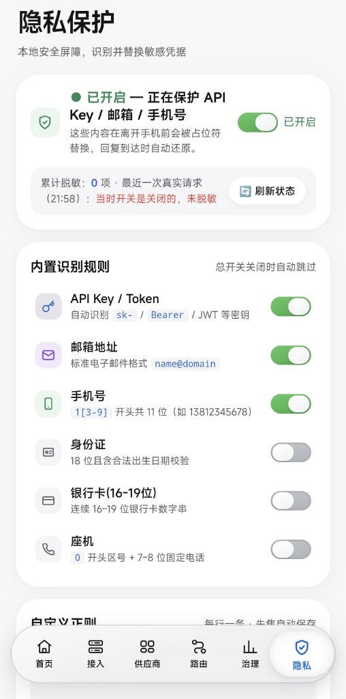
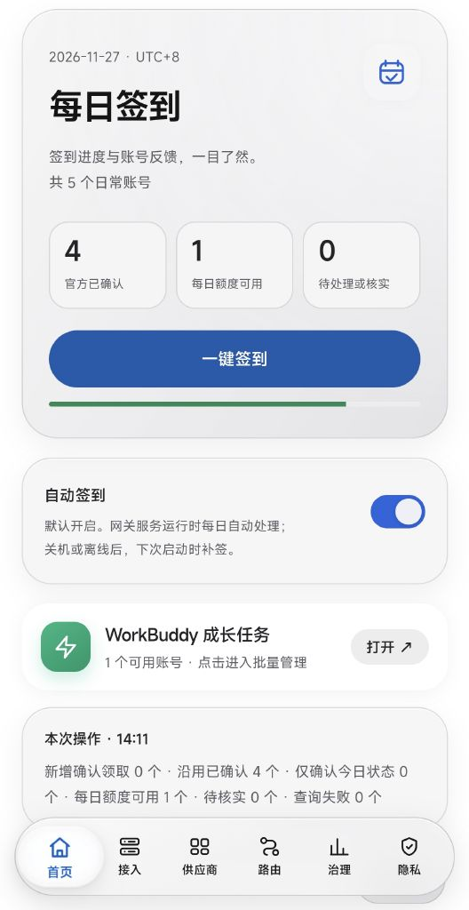
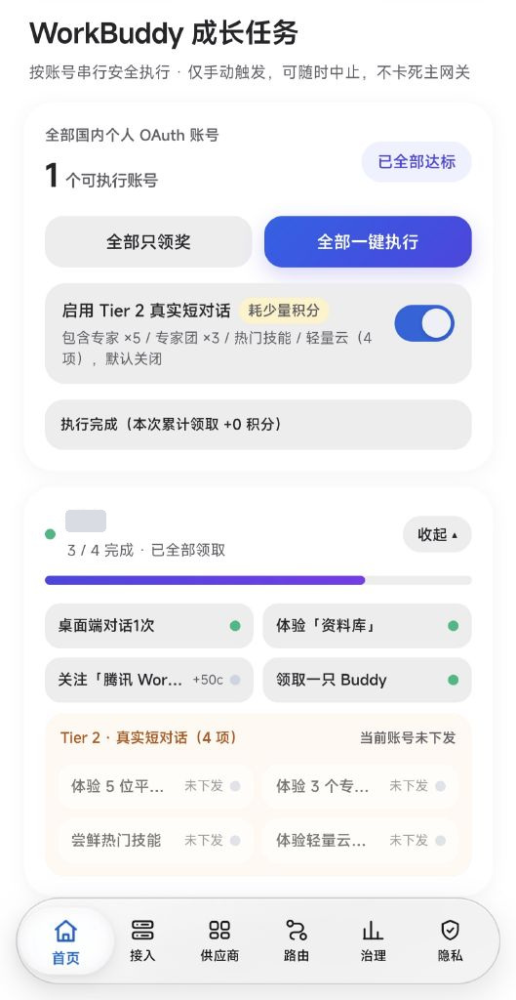

<p align="center"></p>

# All In

**把 Android 手机变成 AI 网关，用一个地址接入多个模型供应商。**

在手机上登录供应商账号或添加 API Key，再把 All In 的网关地址和口令填进 ETA、Claude Code 或其他支持对应协议的客户端。同一部手机和局域网里的电脑都可以接入。模型推理由供应商完成，账号、路由和用量集中在手机上管理。

[下载 APK](https://github.com/xunianooo/All-in/releases/latest) · [更新日志](https://github.com/xunianooo/All-in/releases) · [反馈问题](https://github.com/xunianooo/All-in/issues)

当前发布版为 **1.2.158-test（构建 166）**。[查看本版更新](https://github.com/xunianooo/All-in/releases/tag/v1.2.158-test)

## 界面预览

<table width="100%">
  <tr>
    <td align="center" valign="top" colspan="2" width="33%">
      <strong>网关总览</strong><br>
      <br>
      <sub>查看网关状态、请求统计和账号额度</sub>
    </td>
    <td align="center" valign="top" colspan="2" width="33%">
      <strong>客户端接入</strong><br>
      <br>
      <sub>复制本机或局域网地址与网关口令</sub>
    </td>
    <td align="center" valign="top" colspan="2" width="33%">
      <strong>供应商管理</strong><br>
      <br>
      <sub>管理账号、模型目录和启停状态</sub>
    </td>
  </tr>
  <tr>
    <td align="center" valign="top" colspan="2" width="33%">
      <strong>模型路由</strong><br>
      <br>
      <sub>配置虚拟模型组与故障切换</sub>
    </td>
    <td align="center" valign="top" colspan="2" width="33%">
      <strong>用量与治理</strong><br>
      <br>
      <sub>查看 Token、请求明细和用量热力图</sub>
    </td>
    <td align="center" valign="top" colspan="2" width="33%">
      <strong>隐私保护</strong><br>
      <br>
      <sub>管理脱敏规则和自定义正则</sub>
    </td>
  </tr>
  <tr>
    <td align="center" valign="top" colspan="3" width="50%">
      <strong>每日签到</strong><br>
      <br>
      <sub>查看签到状态和处理结果</sub>
    </td>
    <td align="center" valign="top" colspan="3" width="50%">
      <strong>WorkBuddy 成长任务</strong><br>
      <br>
      <sub>查看任务进度、预计可领奖励和短对话开关</sub>
    </td>
  </tr>
</table>

## 快速开始

1. 从 Releases 下载 APK，安装到 **Android 7.0（API 24）及以上**的设备。从旧版升级时，可以用同签名 APK 直接覆盖安装，保留账号和配置。
2. 打开 All In，按向导完成设置并启动网关。在「供应商」里登录支持的账号或添加 API Key，再查看该账号可用的模型。
3. 在「接入」复制对应的服务地址和网关口令，填入客户端。用模型目录中实际列出的模型 ID 发送第一条请求。

> [!NOTE]
> 覆盖升级会保留旧版手动保存的请求体上限。如果旧限制挡住了长请求，可在「治理 → 网关上下文与超时」把「请求体上限」设为 `0` 并保存。`0` 取消这项网关字节限制，上游模型的上下文限制仍然适用。

| 客户端位置 | OpenAI 兼容 Base URL | Anthropic 服务根地址 |
| --- | --- | --- |
| 与 All In 位于同一部手机 | `http://127.0.0.1:3425/v1` | `http://127.0.0.1:3425` |
| 同一局域网中的电脑或其他设备 | `http://<手机局域网 IP>:3425/v1` | `http://<手机局域网 IP>:3425` |

`3425` 是默认端口。Anthropic 客户端应最终请求 `/v1/messages`，Base URL 的填写方式以客户端设置为准。客户端使用 **All In 网关口令**，供应商凭据留在 All In 中。局域网访问时，以面板显示的地址和实际监听范围为准。

### 用 curl 验证

在环境中设置 `ALLIN_API_KEY` 为面板中的网关口令。从电脑连接时，把 `127.0.0.1` 换成手机的局域网 IP。

```bash
BASE_URL="http://127.0.0.1:3425/v1"
curl -sS "$BASE_URL/models" \
  -H "Authorization: Bearer $ALLIN_API_KEY"
```

复制返回的模型 `id`，替换下例中的 `provider/model`。启用路由组后，可在目录中找到 `group/<组 ID>`。

```bash
curl -sS "$BASE_URL/chat/completions" \
  -H "Authorization: Bearer $ALLIN_API_KEY" \
  -H "Content-Type: application/json" \
  -d '{"model":"provider/model","messages":[{"role":"user","content":"你好"}]}'
```

网关也接受 `x-api-key` 请求头。需要让电脑持续使用网关时，请保持手机的网关前台服务运行。锁屏后如果中断，可以检查通知权限、电池优化和厂商的后台管理设置。

## 供应商与账号

| 接入方式 | 内置适配 |
| --- | --- |
| 账号、订阅或会话 | ZCode、WorkBuddy、Trae CN、CatPaw、小浣熊（Raccoon）、Qoder CN、Cline、Codex、Antigravity、GitHub Copilot、MiniMax Code、DeepSeek 网页版、Loomy |
| API Key 等配置 | WorkBuddy AI、DeepSeek API、SiliconFlow（硅基流动）、OpenAI、Anthropic、OpenRouter、腾讯混元 |

登录方式、模型和额度取决于账号与供应商。Loomy 支持手机验证码登录，也可使用已有会话凭据。部分适配依赖供应商网页或客户端协议，上游变更可能影响登录、模型同步或推理。面板也会显示尚未实现的占位入口，可用模型以实际同步结果为准。

- **多账号管理** · 同一供应商可以管理多个账号或 API Key，按账号启停，分别查看模型或额度。账号可在 Android 应用里用 JSON 文件迁移，整机配置另有密码加密备份。[账号迁移说明](docs/ACCOUNT_JSON_TRANSFER.md)
- **自定义第三方 API** · 可添加 Chat Completions、Responses 或 Anthropic Messages 文本上游，选择认证方式和自定义请求头，在同一菜单拉取、搜索并勾选模型入池。新候选默认不选中，后续同步不会自动新增入池模型。[自定义API说明](docs/CUSTOM_API_PROVIDERS.md)
- **每日签到** · 签到中心显示受支持账号的状态，支持手动触发及网关运行时自动处理；奖励资格由供应商判定，ZCode 赠送通过手动入口领取。
- **WorkBuddy 成长任务** · 在签到中心打开独立页面，按账号查看任务进度，可手动执行或只领取已达标奖励。适用于国内个人 OAuth 账号。Tier 2 真实短对话默认关闭，开启后会消耗少量积分。

## 模型路由与用量

客户端可以用 `provider/model` 指定供应商模型，也可以用 `group/<组 ID>` 请求路由组。路由组默认关闭。启用后，可为同一入口配置多个候选模型，并选择顺序主备、轮询均摊、手动指定或低负载策略。模型白名单用于控制对外可用的模型。裸模型名兜底默认关闭。

同一供应商内可选 **轮流、用量均衡、到期优先**。用量均衡优先比较可信的额度使用比例，缺少可比数据时参考本机近期 Token 与在途负载。到期优先使用供应商明确提供的额度到期或重置信息。模型权限、账号启停和冷却状态仍参与选路。[账号路由说明](docs/ACCOUNT_ROUTING.md)

「用量与治理」可查看 Token 统计、用量热力图和调用明细。诊断支持按供应商和失败类型筛选、查看前置拦截及导出 CSV。账本区分已知、部分已知、估算与未知用量。对于部分执行结果未知的请求，网关会停止自动重试，以避免重复执行或重复扣费。

## API 与模型能力

| 方法和路径 | 用途 |
| --- | --- |
| `GET /v1/models` | 查看网关对当前客户端提供的模型及路由组 |
| `POST /v1/chat/completions` | OpenAI Chat Completions |
| `POST /v1/responses` | OpenAI Responses |
| `POST /v1/messages` | Anthropic Messages |
| `POST /v1/images/generations` | 图片生成，适配 MiniMax Code 国区、Codex 和 Loomy |
| `POST /v1/images/edits` | MiniMax Code 国区参考图生成 |
| `POST /v1/videos` | 提交 MiniMax Code 国区视频任务 |
| `GET /v1/videos/{id}` | 查询视频任务 |
| `GET /v1/videos/{id}/content` | 获取已完成的视频 |

文本接口按所选路径处理普通 JSON 或 SSE 流式响应。工具调用、图片输入、推理字段和其他扩展能力取决于客户端协议、上游适配与具体模型。遇到无法安全转换的字段，相关路径会返回错误。[Responses 转换说明](docs/responses-bridge.md) · [Agent 字段兼容性](docs/responses-agent-compatibility.md)

Codex 生图使用 `codex/gpt-image-2`，Loomy 生图使用目录中的 `loomy/<模型 ID>`。MiniMax Code 国区生图使用 `minimax-code/MiniMax-Image`。视频可选择 `minimax-code/MiniMax-H3`、`minimax-code/MiniMax-H3-Max` 或 `minimax-code/MiniMax-Hailuo-2.3`，以面板实际目录为准。使用参考图时，可按接口提交 HTTPS URL、图片 data URL 或 multipart 文件。提交视频任务后，保留返回的完整 ID，并使用原网关口令查询或下载。媒体功能受上游账号权限、额度和频率限制。

## 访问与凭据

- 新安装会生成随机网关口令。旧版升级后若仍使用公开默认口令，请先在面板更换，再从其他设备连接。面板的管理接口使用独立管理凭据，推理客户端只需网关口令。
- 网关提供 HTTP。局域网请求的内容和口令没有 TLS 加密，请在可信网络使用，避免直接将服务暴露到公网。
- 账号 JSON 包含明文凭据。请保护这些文件及备份，提交 Issue 前先移除口令、Token、验证码、账号信息和敏感对话。
- 上游请求受供应商的服务条款、权限、额度和计费约束。启用脱敏规则时，也请确认请求中可发送给上游的内容。

## 从源码构建

使用 JDK 17、Android SDK Platform 37.0 和仓库自带的 Gradle Wrapper。仓库配置为 `minSdk 24`、`targetSdk 34`、`compileSdk 37`。[SDK 配置说明](docs/sdk.md)

```bash
./gradlew :app:assembleDebug
./gradlew :app:offlineTests
./gradlew :app:setupKeyHttpTests :app:streamingHttpTests :app:outboundRoutingHttpTests
```

Windows 使用 `gradlew.bat`。Debug APK 在 `app/build/outputs/apk/debug/`。GitHub Actions 的 Windows 与 Ubuntu CI 由维护者在 Actions 页面手动触发，另包含管理面板回归测试。Release APK 需要自行配置签名，同一应用的覆盖升级要求签名匹配。[CI 工作流](.github/workflows/ci.yml) · [签名说明](docs/RELEASE_SIGNING.md)

## 反馈与贡献

欢迎提交 Issue 或 Pull Request。报告兼容性问题时，请附上 All In 版本、Android 版本、客户端及协议、供应商及模型、复现步骤和脱敏错误信息。[GitHub Issues](https://github.com/xunianooo/All-in/issues)

## 致谢

感谢开源项目的作者与维护者，以及提供反馈、复现问题和参与测试的朋友。第三方许可和原版权声明见[第三方声明](docs/THIRD_PARTY_NOTICES.md)及[应用内附带的许可](app/src/main/assets/licenses/)。

## 使用声明

### 仅供个人学习与研究

All In 是一个技术实践项目，用于学习在 Android 上搭建本地 HTTP 服务、SSE 流式转发、多上游协议适配以及 Jetpack Compose 应用打包等课题，**仅供个人学习与研究使用**。它不是任何厂商的官方产品，与项目涉及的服务方——包括腾讯、WorkBuddy、商汤与小浣熊、字节跳动与 Trae、科大讯飞与 Loomy、Google 与 Antigravity、OpenAI 与 ChatGPT 等——均无官方关联，也未获得上述任何一方的授权、认可或赞助。

### 关于请求转发

本项目在用户自己的设备上运行：由使用者自行配置账号或 API Key，请求经本地网关转发到对应服务商的官方接口，模型推理仍由服务商完成。项目不破解登录、不绕过付费或权限校验，消耗的额度来自使用者自己账号本就拥有的配额。但需要说明的是，这种以非官方客户端形态转发请求的方式，**可能不符合相关服务的用户协议或使用条款**；是否使用由使用者自行决定，由此产生的后果（包括但不限于账号被限流、触发风控、被冻结或封禁）也由其本人承担。

### 使用限制

禁止将 All In 用于任何商业用途、转售或二次分发牟利、批量运营账号、规避上游计费与配额限制，以及其他违反所在地法律法规的活动。如需在生产环境或商业场景中调用模型服务，请改走服务方提供的官方渠道与官方 API。

## 许可证

All In 由 [Gaeul](https://github.com/xunianooo) 开发，采用 [MIT License](LICENSE)。第三方代码与资源遵循各自许可，详见[第三方声明](docs/THIRD_PARTY_NOTICES.md)及[随应用分发的许可](app/src/main/assets/licenses/)。
